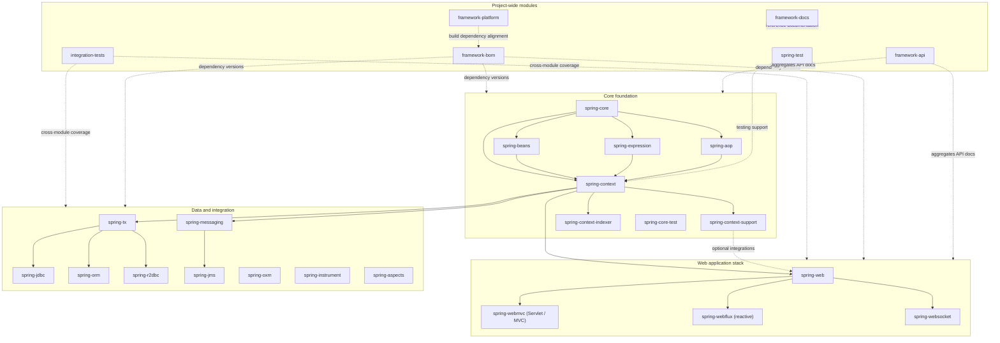

# Spring Framework Project Overview

Spring Framework is a modular Java framework for building enterprise
applications. It provides foundational APIs for dependency injection,
application configuration, data access, messaging, and web applications.
The modules can be used together or selected individually, with optional
integrations for third-party libraries and runtimes.

## Architecture

The diagram shows the main module layers and common dependency direction.
It is a high-level guide: actual dependencies vary by feature and some are
optional.



## Main areas

- **Core container:** `spring-core`, `spring-beans`, `spring-expression`,
  `spring-aop`, and `spring-context` provide utilities, dependency injection,
  expression evaluation, proxy-based aspects, and application configuration.
- **Web:** `spring-web` supplies shared web infrastructure. `spring-webmvc`
  supports Servlet-based MVC applications, while `spring-webflux` supports
  reactive applications. `spring-websocket` adds WebSocket support.
- **Data and integration:** transaction management (`spring-tx`) underpins
  JDBC, ORM, and R2DBC support. Messaging, JMS, object/XML mapping, and
  instrumentation are provided by their respective modules.
- **Testing and project support:** `spring-test` offers test integration;
  `integration-tests` exercises combinations across modules. The BOM and
  platform modules manage dependency versions and build alignment. The API
  and reference documentation are maintained in dedicated modules.

## Repository layout

Each `spring-*` directory is a Gradle subproject. `settings.gradle` lists the
included modules, and the root `build.gradle` applies shared build conventions
and dependency management. Reference documentation sources live in
`framework-docs/modules/ROOT`; contributor setup and build instructions are in
[`CONTRIBUTING.md`](CONTRIBUTING.md).

## Build and tests

The project uses Gradle. Follow the JDK requirements and setup in
[`CONTRIBUTING.md`](CONTRIBUTING.md), then run a scoped module build, for
example:

```sh
./gradlew :spring-context:test
```

Use `./gradlew :<module>:check` to run that module's checks, including tests
and style checks.
